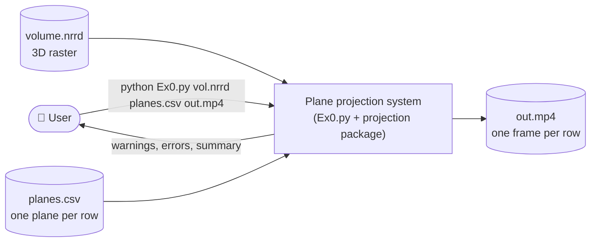
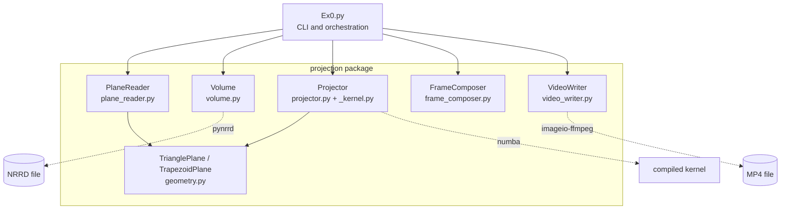
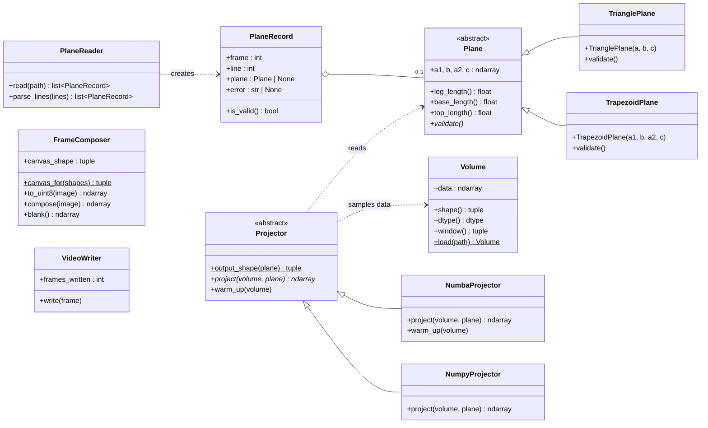
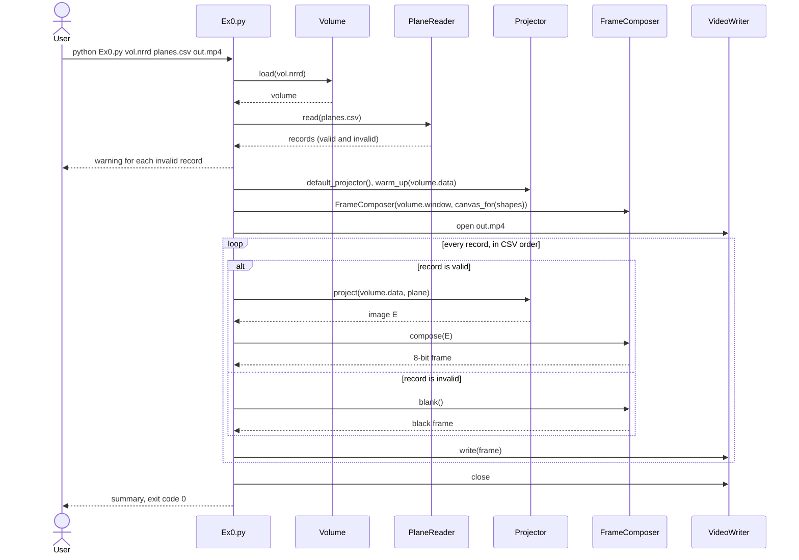

# Software Design Description (SDD)
## Project: 3D Volume Plane Projection (Ex1)

## 1. Introduction
This document describes how the system is structured: its parts, how they connect, the data they exchange, where they run, and why.

It sits in this chain of documents:

| Document | Question it answers |
|---|---|
| [SRS.md](SRS.md) | What the system must do, and its use cases |
| **SDD.md** (this document) | How the system is structured |
| [ALGORITHM.md](ALGORITHM.md) | How the projection component is built. This is the detailed design (EDD) of `Projector` |
| [TESTING.md](TESTING.md) | How we test (STP), and the test cases (STD) |
| [docs/adr/](docs/adr/) | Why each major decision was taken |

Diagrams are written in Mermaid ("diagrams as code"), so GitHub renders them and they are reviewed in pull requests like the code.

## 2. Context
The system is a command-line program that runs on one machine. It reads two files and writes one.

## 3. Decomposition

### 3.1 Components

| Component | Responsibility | Depends on |
|---|---|---|
| `Ex0.py` | Parses arguments, wires the components together, reports warnings and errors, and maps failures to exit codes | All components |
| `PlaneReader` | Turns CSV lines into `PlaneRecord`s, each holding either a valid plane or an error | `geometry` |
| `TrianglePlane`, `TrapezoidPlane` | Hold the four scan points `a1, b, a2, c` and validate them against SRS FR-3 | NumPy |
| `Volume` | Loads the NRRD as `data[x, y, z]` and computes the intensity window | pynrrd |
| `Projector` | Computes the image E of a plane through the volume (detailed in ALGORITHM.md) | `geometry`, Numba (optional) |
| `FrameComposer` | Maps E to 8 bits and places it on a fixed, even-sized canvas | NumPy |
| `VideoWriter` | Encodes frames to H.264 MP4 | imageio-ffmpeg |

Each component has one reason to change. Only `Ex0.py` knows about files and exit codes. `Projector` takes a plain NumPy array, so it can be tested without any files (NFR-4).

### 3.2 Classes

- **Two hierarchies, each a strategy.** `Plane` hides whether the input was 3 or 4 points: a triangle is stored as a trapezoid with `a1 == a2`, so the projector has a single code path. `Projector` hides which implementation runs. `default_projector()` picks Numba when it is installed and NumPy otherwise. Callers depend only on the abstract classes.
- **Errors are values, not crashes.** An invalid row becomes a `PlaneRecord` with an `error` message instead of an exception that stops the run. This is how FR-6 keeps "frame i matches row i". `InvalidPlaneError` and `VolumeLoadError` are used only inside the package, and at the CLI boundary.

## 4. Dynamic view: one run of `Ex0.py`

**Error handling at the boundary.** `Ex0.main` converts failures into exit codes:
- `VolumeLoadError`, a missing input file or a missing output folder → message on stderr and exit code 1.
- `OSError` while writing the video → "cannot write output" and exit code 1.
- Wrong number of arguments → usage line and exit code 2.

No stack trace reaches the user for an expected failure (NFR-2).

## 5. Data

| Data | Format | Notes |
|---|---|---|
| Volume (input) | NRRD, any integer or float type, 3D, each axis ≤ 1023 | Loaded with pynrrd's default Fortran index order, so `data[x, y, z]` matches CSV coordinates. Spacing and origin are ignored (ADR-0003) |
| Planes (input) | CSV: `n, x1,y1,z1, …, x4,y4,z4`, with a header row, blank lines and `#` comments allowed | 4-point rows are in leg order `a1, b, a2, c` (ADR-0001) |
| `PlaneRecord` | `frame`, `line`, `plane` or `error` | `frame` is the 1-based data row number |
| Image E | `(⌊leg⌋+1) × (⌊base⌋+1)` array, same dtype as the volume | Stored as `E[y, x]` (ALGORITHM.md) |
| Frame | `uint8`, canvas size = maximum E size, rounded up to even | One window for the whole volume (FR-5) |
| Video (output) | MP4, H.264, yuv420p, 10 FPS | One frame per CSV data row |

## 6. Deployment
- One Python process on the user's machine (Windows, macOS or Linux), with no network access and no server.
- `NumbaProjector` spreads rows across all CPU cores (`numba.prange`). The compiled kernel is cached in `projection/__pycache__`, so only the first run pays the roughly 1 s compile time.
- Memory: the volume is held once (125 MB for 500³ uint8, up to 4.3 GB for 1023³ uint32), plus one image and one frame at a time.

## 7. Design rationale
The major decisions are recorded as Architecture Decision Records:

| ADR | Decision |
|---|---|
| [ADR-0001](docs/adr/0001-csv-point-order.md) | 4-point CSV rows are read in leg order `a1, b, a2, c` |
| [ADR-0002](docs/adr/0002-invalid-rows-black-frames.md) | Invalid rows give a warning and a black frame; the run continues |
| [ADR-0003](docs/adr/0003-voxel-coordinates.md) | Coordinates are voxel indices; NRRD spacing is ignored |
| [ADR-0004](docs/adr/0004-half-pixel-margin.md) | Pixels within half a pixel of a row's span are inside, sampled at the clamped point |
| [ADR-0005](docs/adr/0005-numba-projector.md) | The default projector is a Numba-compiled parallel loop, with NumPy as fallback |
