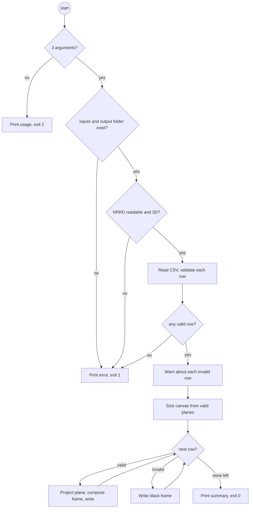

# Software Requirements Specification (SRS)
## Project: 3D Volume Plane Projection (Ex1)

## 1. Introduction

### 1.1 Purpose
This document defines the requirements for the "3D Volume Plane Projection" system. The system samples a 3D volume along a planar shape (an isosceles triangle or an isosceles trapezoid) and produces a 2D image of it. A sequence of such images is written out as a video.

### 1.2 Scope
The system reads 3D raster data (NRRD) and a list of planes (CSV), computes one 2D projection per plane, and writes the projections as frames of an MP4 video. Runtime performance of the projection is a primary concern.

### 1.3 Definitions
| Term | Meaning |
|---|---|
| **M** | The input volume, a 3D matrix of size `sx × sy × sz`, accessed as `M[x][y][z]`. |
| **Plane** | One CSV row: 3 points `(a, b, c)` or 4 points `(a1, b, a2, c)`. |
| **E** | The output 2D image computed for one plane. |
| **EPS** | Geometric tolerance, `0.001`. |
| **Frame** | E after conversion to an 8-bit image of the video's size. |

## 2. Functional Requirements

### FR-1: Volume loading
- The system shall load a 3D volume from a `.nrrd` file.
- Supported sizes: `1 ≤ sx, sy, sz < 2^10` (at most 1023 per axis).
- Supported value types: unsigned 8, 16 and 32-bit integers, as the assignment requires. Signed integers and floats shall also be accepted, because the class dataset's MRHead is int16.
- The CSV point `(x, y, z)` shall address voxel `M[x][y][z]`, in the NRRD file's own axis order.
- Coordinates are **voxel indices**. The NRRD's physical geometry (`space directions`, `space origin`) is ignored ([ADR-0003](docs/adr/0003-voxel-coordinates.md)).

### FR-2: Plane file (CSV) parsing
The system shall read the plane list in the format published with the assignment (see [data/lecturer_example.csv](data/lecturer_example.csv)):

```
Number of Points (3 or 4),x1,y1,z1,x2,y2,z2,x3,y3,z3,x4,y4,z4
3,200,200,0,0,200,400,400,200,400,,,
4,200,0,0,200,0,500,200,400,0,200,400,500
```

- The first line is a header and is skipped.
- Blank lines and lines starting with `#` (comments) are skipped.
- Each remaining line is one plane, and therefore one video frame.
- Column 1 is the point count `n ∈ {3, 4}`. It is followed by `3n` coordinates. When `n = 3`, the last three columns are empty.
- Coordinates are real numbers. They may be negative or lie outside the volume.
- 3 points are read as `(a, b, c)`, with `a` the apex. 4 points are read in **leg order** `(a1, b, a2, c)`: the first leg `a1→b`, then the second leg `a2→c`. `a1–a2` is the short (top) base and `b–c` the long (bottom) base. See [ADR-0001](docs/adr/0001-csv-point-order.md) for why.

### FR-3: Plane validation
Every plane shall be validated before it is projected, using `EPS = 0.001`:

| Shape | Conditions |
|---|---|
| Triangle `(a, b, c)` | `\|dist(a,b) − dist(a,c)\| < EPS`; `dist(a,b) > 0`; `dist(b,c) > 0`; `a` is not on the line `b–c` |
| Trapezoid `(a1, b, a2, c)` | `\|dist(a1,b) − dist(a2,c)\| < EPS`; `dist(a1,a2) ≤ dist(b,c)`; all four points are coplanar (the distance from `a2` to the plane through `a1, b, c` is `< EPS`); the legs have non-zero length; **the legs do not cross** (`a1→a2` points the same way as `b→c`) |
| Both | All coordinates are finite. No leg or base is longer than `MAX_SIDE = 2·√3·1023 ≈ 3544` voxels, twice the diagonal of the largest allowed volume, so the image stays a sensible size |

A row that is malformed (wrong column count or non-numeric values) or that fails validation is an **invalid plane** (see FR-6).

### FR-4: Projection
- For each valid plane, the system shall compute E using backward mapping, as defined in [ALGORITHM.md](ALGORITHM.md).
- Sampling uses nearest-neighbour lookup.
- A sample point outside `[0, sx) × [0, sy) × [0, sz)` gets the value `0`.
- Pixels of E outside the triangle or trapezoid are `0`.

### FR-5: Video generation
- The system shall write all frames to a single `.mp4` file, in the same order as the CSV rows.
- **Frame size.** Images E differ in size from plane to plane, but a video needs a fixed frame size. Each E is placed, top-aligned and horizontally centred, on a canvas whose height and width are the maximum over all valid planes, each rounded up to an even number, which common MP4 codecs require. E is not scaled, so one image pixel stays one voxel step.
- **Intensity mapping.** Volume values are mapped linearly to `0–255`, using a single window computed once from the whole volume (its min and max). A shared window avoids flicker between frames.

### FR-6: Invalid planes
- An invalid plane does not stop the run. The system prints a warning naming the row number and the failed condition, and writes an all-black frame in that position, so **frame i always corresponds to CSV row i** ([ADR-0002](docs/adr/0002-invalid-rows-black-frames.md)).
- If no row is valid, or the volume cannot be loaded, the program exits with a non-zero code and an error message.

### FR-7: Command-line interface
```
python Ex0.py <file.nrrd> <file.csv> <file.mp4>
```
- Wrong argument count, a missing input file or an unwritable output path produce a usage or error message and a non-zero exit code. The program must not show a raw stack trace.

## 3. Non-Functional Requirements

### NFR-1: Performance (critical)
- For a `500³` uint8 volume, projection throughput shall be **≥ 30 FPS**, with a target of **≥ 100 FPS**.
- FPS is measured on the projection step alone (computing E from M and a plane), averaged over the frames of a run. File I/O and video encoding are excluded.

### NFR-2: Robustness
- The system shall handle missing files, wrong formats, malformed CSV rows and degenerate or invalid geometry without crashing (FR-6, FR-7).
- Given enough memory, the system shall handle the largest allowed volume: 1023³ uint32, about 4.3 GB.

### NFR-3: Software design
- The code shall follow OOP/OOD principles. Loading, parsing, validation, projection, frame composition and video encoding shall be separate components, each with one responsibility. The components are described in [SDD.md](SDD.md).

### NFR-4: Testability
- Every component shall be testable in isolation. In particular, projection shall be testable on in-memory volumes, without any files.

## 4. System Environment
- **Language:** Python 3.10+ (dependencies in `requirements.txt`)
- **Interface:** command line only, no GUI
- **OS:** cross-platform (Windows, macOS, Linux)

## 5. Use cases

The system has one actor, the **User** (for example a student or the grader), and one user goal. Performance checking is a developer task, covered by test case TC-44 rather than by a use case.

### UC-01: Render a projection video
| | |
|---|---|
| **Actor** | User |
| **Preconditions** | Python and `requirements.txt` are installed. An NRRD volume and a plane CSV exist. |
| **Trigger** | `python Ex0.py <file.nrrd> <file.csv> <file.mp4>` |
| **Postcondition** | `<file.mp4>` holds exactly one frame per CSV data row, in row order, and the exit code is 0. |

**Main success flow**
1. The User runs `Ex0.py` with the three paths.
2. The system checks that both input files and the output folder exist (FR-7).
3. The system loads the volume (FR-1).
4. The system reads the CSV and validates every plane (FR-2, FR-3).
5. The system sizes the video canvas from the valid planes (FR-5).
6. For each row, in order, the system projects the plane, converts the image to an 8-bit frame on the canvas, and writes it (FR-4, FR-5).
7. The system prints a summary (frames written, frames black, projection FPS) and exits with code 0.

**Alternative flows**
- **2a.** Wrong number of arguments: the system prints the usage line and exits with code 2.
- **2b.** An input file or the output folder is missing: the system prints an error and exits with code 1.
- **3a.** The file is not a readable 3D NRRD, or an axis is larger than 1023: the system prints an error and exits with code 1.
- **4a.** A row is malformed or fails validation: the system prints a warning with the frame number, line number and reason. In step 6 it writes a black frame for that row (FR-6).
- **4b.** No row is valid: the system prints an error and exits with code 1.
- **6a.** A plane lies partly or fully outside the volume: those pixels are black. This is not an error and gives no warning (FR-4).



## Appendix A: Traceability matrix

This matrix links each requirement to its use case, design, code and test cases. The test cases (`TC-xx`) are listed in [TESTING.md](TESTING.md#5-test-description-std) and the decisions (`ADR-xxxx`) in [docs/adr/](docs/adr/). Status is from the last run of `python -m pytest` and the benchmark, on 2026-10-26.

| Requirement | Use case | Design | Code | Test cases | Status |
|---|---|---|---|---|---|
| FR-1 Volume loading | UC-01 step 3 | SDD §3, ADR-0003 | `volume.py` | TC-27, TC-28, TC-37, TC-38, TC-39 | Passed |
| FR-2 CSV parsing | UC-01 step 4 | SDD §3, ADR-0001 | `plane_reader.py` | TC-04, TC-05, TC-15–TC-20 | Passed |
| FR-3 Plane validation | UC-01 step 4 | SDD §3 | `geometry.py` | TC-01–TC-13, TC-20, TC-43 | Passed |
| FR-4 Projection | UC-01 step 6 | ALGORITHM.md | `projector.py`, `_kernel.py` | TC-14, TC-21–TC-31, TC-43, TC-45 | Passed |
| FR-5 Video generation | UC-01 steps 5–6 | SDD §4 | `frame_composer.py`, `video_writer.py` | TC-32–TC-36, TC-40, TC-45, TC-46 | Passed |
| FR-6 Invalid planes | UC-01 alt. 4a, 4b | ADR-0002 | `plane_reader.py`, `Ex0.py` | TC-15, TC-19, TC-36, TC-40, TC-42, TC-43 | Passed |
| FR-7 Command line | UC-01 steps 1–2, alt. 2a, 2b | SDD §4 | `Ex0.py` | TC-40, TC-41 | Passed |
| NFR-1 Performance | — | ALGORITHM.md §5, ADR-0004 | `_kernel.py`, `projector.py` | TC-30, TC-44 | Passed (453 FPS worst case) |
| NFR-2 Robustness | UC-01 alt. flows | SDD §4 | all | TC-09, TC-11, TC-12, TC-19, TC-25, TC-33, TC-38, TC-41 | Passed |
| NFR-3 Software design | — | SDD §2–3 | `projection/` | Design review in pull request | Reviewed |
| NFR-4 Testability | — | SDD §3 | `projector.py` | TC-29, TC-30 | Passed |
